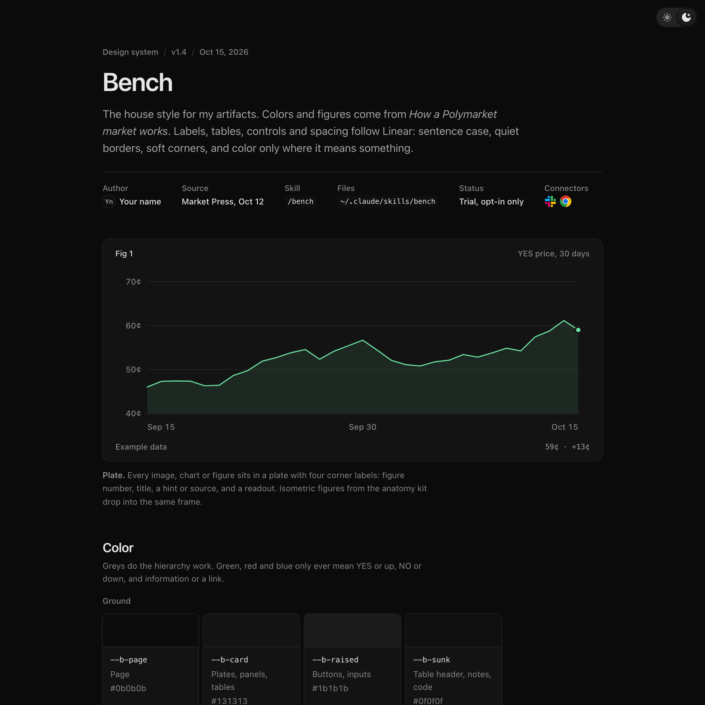

# Bench

Bench is a house style for the HTML pages an AI agent writes for you: memos, readouts, explainers, small tools. It ships as an agent skill. The agent writes the content and picks a layout, and a build script pastes in the shared CSS, icons and masthead, so every page comes out looking like the same publication.



The look is a warm paper ground with charts and figures framed in labeled plates, Linear-style labels and controls, Medusa-style tables, Nucleo icons, light and dark themes, and a fixed masthead with the author's name and photo. Color only appears where it means something: green for yes or up, red for no or down, amber for in progress, blue for links.

## Install

### Claude Code

```sh
git clone https://github.com/digitdustin/bench ~/.claude/skills/bench
```

Then type `/bench` in Claude Code and describe the page you want. The skill is opt-in (`disable-model-invocation: true`), so Claude only uses it when you run `/bench` or ask for "the Bench style".

You can also hand the install to your agent:

> Install the Bench skill from https://github.com/digitdustin/bench into ~/.claude/skills/bench, then set my name in assets/author.json.

### Claude.ai and the Claude desktop app

Download `bench-skill.zip` from the [latest release](https://github.com/digitdustin/bench/releases/latest) and upload it under Settings > Capabilities > Skills. That zip leaves out the 43 MB Desk themes example so it stays small. `bench-full.zip` has everything.

### Other agents (Codex, Cursor, etc.)

Clone the repo anywhere and tell the agent to read `SKILL.md` before building a page. The build only needs Node.

## Set your name

The build adds an Author field to every masthead. Edit `assets/author.json`:

```json
{ "label": "Author", "name": "Ada Lovelace" }
```

Drop a square photo at `assets/avatar.jpg` (or `.png`/`.webp`) to show it next to your name. Without one, the build shows your initials.

## How a page gets built

1. The agent copies a template from `templates/` (memo, readout, explainer or tool) to `<slug>.src.html`.
2. It fills in the masthead and writes the body using markup from `references/components.md`.
3. It runs the build:

   ```sh
   node ~/.claude/skills/bench/scripts/build.mjs page.src.html
   ```

   The build runs `scripts/check.mjs` first and stops on anything off-system: literal colors, fonts or radii, uppercase text, leftover `{{placeholders}}`, missing width declarations. Then it inlines the CSS, JS, icons, status chips, connector logos and author into one self-contained `page.html` you can publish as an artifact or open in a browser.

Markers the build understands:

| Marker | Becomes |
|---|---|
| `<!--bench:css-->` | All of Bench's CSS and JS |
| `<!--icon:caret-up:12:fill-->` | An inline Nucleo icon (12 or 18 grid, outline or fill) |
| `<span class="b-chip" data-status="progress">` | A status chip with the matching status icon |
| `<!--bench:connectors hex notion-->` | Connector logos in the details row (names from `assets/connectors/`) |
| `<!--bench:figure name-->` | An isometric figure from the `anatomy` skill, restyled to fit |
| `<span class="b-delta" data-dir="up">` | A change value with a filled caret |

## What's in the repo

```
SKILL.md        instructions the agent follows: workflow and hard rules
DESIGN.md       the written spec: principles, tokens, components, layouts, changelog
src/            tokens.css, bench.css, bench.js, mockups.css, mockups.js
templates/      memo, readout, explainer, tool
references/     components.md, charts.md, mockups.md (copy-paste markup)
scripts/        build.mjs, check.mjs, icons.py
icons/          94 exported Nucleo UI icons
assets/         author.json, connector logos, status icons
specimen/       source of the design-system page (built copy in dist/bench.html)
examples/       full pages built with Bench, plus the Market Press page it came from
```

Open `dist/bench.html` in a browser to see every token and component.

## Requirements

- Node 18 or newer for the build.
- Python 3 and the [Nucleo](https://nucleoapp.com) Mac app only if you want icons beyond the 94 already in `icons/`. `scripts/icons.py --search word` looks up names in your local Nucleo library and the build exports new ones on the fly.
- The `anatomy` skill only if you want isometric figures. The Market Press example imports it from `~/.claude/skills/anatomy`.

## Examples

- `examples/market-press/`: "How a Polymarket market works", the page Bench grew out of, with its isometric figure sources.
- `examples/before-we-ship-5m/`: a decision memo.
- `examples/settlement-glide/`: a product explainer with vertical tabs and stats.
- `examples/suggest-feature/`: user flows drawn with the 2D mockup kit.
- `examples/dustin-voice/`: a readout about a writing-style skill.
- `examples/desk-themes/`: theme studies for a terminal app, with screenshots. The lab scripts expect `node-pty` and `@xterm/xterm` installed next to them.

Build any of them with `node scripts/build.mjs examples/<name>/<name>.src.html`.

## Changing the system

Bench stays consistent because pages never add their own styles. To add a token or component, change `src/`, add its markup to `references/components.md`, show it in `specimen/bench.src.html`, and log it in the DESIGN.md changelog, all in the same change. Then rebuild the specimen:

```sh
node scripts/build.mjs specimen/bench.src.html dist/bench.html
```

## Credits and licenses

The Bench code and docs are by Dustin Karp. Some bundled files belong to other people and keep their own terms:

- Icons in `icons/` are from [Nucleo](https://nucleoapp.com) (Nucleo UI), which is a paid license.
- Logos in `assets/connectors/` are trademarks of their companies.
- The status icons in `assets/status/` are custom Slack emoji from the Polymarket workspace.
